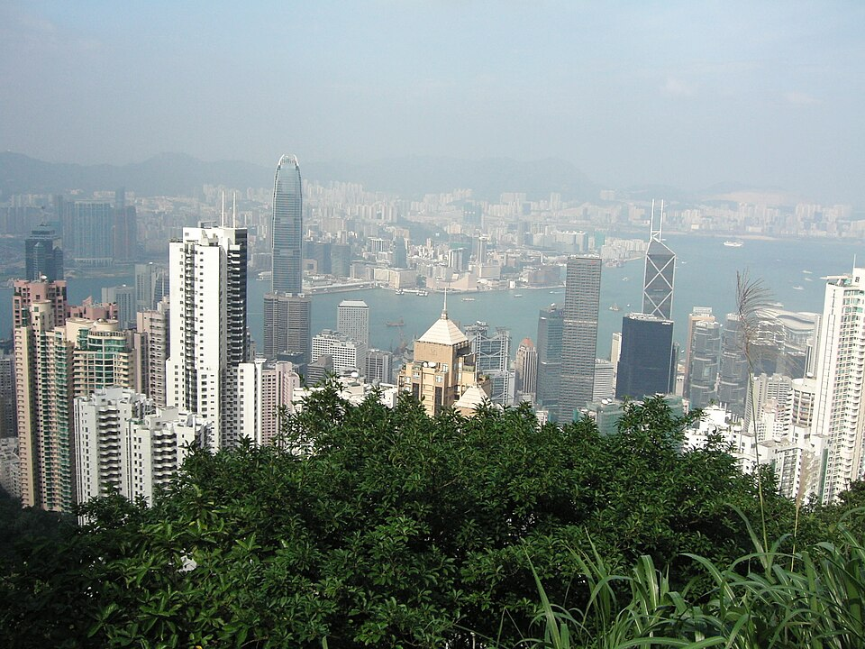

**** Imagine a city where a simple slab of concrete (for a parking space) sells for $167,000, and a modest 400-square-foot studio apartment easily commands over a million dollars. You might assume such a city has simply run out of room. But if you look out the window of that million-dollar micro-apartment, you won't see an endless concrete jungle. You will see lush, untouched tropical mountains. In fact, 75% of this territory is completely empty. This city is none other than Hong Kong.

image: Hong Kong

Today, that era is over. In this blog, I will explain to you how China scarified Hong Kong’s economy for an absolute control.  

## **The Golden Goose: An Artificial Economy**

To understand how Hong Kong collapsed, you have to understand how it was funded. The city was never a standard free-market haven; it was a carefully orchestrated government monopoly. The Hong Kong government owns 100% of the territory's land, by intentionally hoarding three-quarters of it and auctioning off microscopic fractions to the highest bidder—sometimes as little as 0.013 square miles in a single year. The government essentially printed money through engineered scarcity.

This astronomical revenue from land sales historically funded a third of the entire city budget. It allowed the government to provide world-class infrastructure and healthcare while charging a maximum income tax rate of just 16%, with zero sales or capital gains taxes.

But this model required a strict political tightrope. The city needed freedom to attract foreign capital, but it could never allow true democracy. If the working class could vote, their first mandate would be to release the hoarded land. That would instantly lower housing costs, but it would bankrupt the government's revenue model overnight.

  

## **Painting it on its own image**

This fragile equilibrium shattered in 2019. Sparked by a loophole involving a 19-year-old murderer in Taiwan, a proposed Extradition Bill threatened to subject Hong Kong citizens directly to mainland China's opaque legal system. The ensuing protests were massive, and the public's mandate was undeniable: in the 2019 local elections, the pro-democracy camp won 57% of the popular vote and seized an overwhelming 388 out of 452 seats.

Beijing recognized that rolling military tanks into a global financial capital would destroy its economic value instantly. Instead, they neutralized the threat via "lawfare."

In 2020, Beijing bypassed Hong Kong's local legislature to impose a sweeping National Security Law (NSL). It established a parallel legal framework with government-vetted judges, secretive trials, and the criminalization of vague concepts like "subversion." Suddenly, the legal firewall between the mainland and Hong Kong evaporated.

To ensure the 2019 democratic landslide could never happen again, Beijing engineered complex electoral reforms in 2021. The legislature was expanded to 90 seats, but the number directly elected by the public was slashed to just 20. The Chief Executive is now chosen by an Election Committee heavily skewed by "functional constituencies," where 42.5% of seats are controlled by corporations rather than citizens.

  

## **Erasing the Borders**

The dismantling extended beyond the courts. Infrastructure projects, like the massive West Kowloon high-speed railway station, were weaponized to blur sovereign borders. By allowing mainland immigration officials to operate inside the station, Beijing established a zone deep within Hong Kong where mainland laws are actively enforced.

Furthermore, the city was forced into a disastrous alignment with Beijing's "zero-COVID" policies, leading to severe isolation and thousands of casualties, starkly contrasting with sovereign rivals like Singapore.

Because the legal firewall was gone, Chinese capital realized it was no longer safe. Mainland billionaires and Western expats alike began pulling their money out, sending it to Singapore, London, and Vancouver. Hong Kong's property demand plummeted, and the government's land auctions began to fail.

 

Desperate to stop the bleeding and lure mainland money back, the Hong Kong government abruptly cancelled all major property cooling measures in early 2024. Practically overnight, the punitive buyer's stamp duties that had previously slapped a massive tax on mainland and foreign buyers were abolished. This dropped the effective tax rate for a mainland Chinese buyer on a typical home from roughly 15% down to just 4.25%, placing them on equal footing with local residents. It was a clear signal: as Western capital fled, Hong Kong would attempt to pivot its entire economic reliance toward mainland integration.

  
  

## **Last Nail in The Coffin**

By 2026, the transition into a heavily integrated Chinese tech and finance centre is complete, marked by several permanent structural shifts:

- **February 2026:** Marked by the sentencing of 78-year-old pro-democracy media mogul Jimmy Lai to 20 years in prison for "collusion with foreign forces." A trial overseen by three government-vetted judges that definitively ended the illusion of a free press.

- **Talent Pass Scheme:** To combat the mass exodus of global talent, the government launched the Top Talent Pass Scheme. While it successfully brought over 100,000 professionals to the city, over 95% of approved applicants are from mainland China. The cosmopolitan, international diversity that once defined the city is being rapidly substituted with mainland demographics.

- **Fiscal Strain:** Because Hong Kong is no longer a safe haven, Chinese capital is fleeing and due to strict National Security laws, international demand also collapsed, the government's land monopoly model is fundamentally broken. To engineer a surface-level surplus, the city has resorted to issuing massive amounts of government bonds and slashing thousands of civil service jobs. A city that once practically printed money is now taking on debt to fund its daily operations.

 

## **Singapore: A new Alternative**

Global capital values predictability. As the legal and political landscape in Hong Kong fractured, Western businesses fled. The number of American businesses with regional headquarters in Hong Kong has plummeted to 214, its lowest count since the year 2000.

Singapore has emerged as the primary beneficiary. It offers everything Hong Kong used to—high English proficiency, Western legal frameworks, and cosmopolitan infrastructure—but with the added guarantee of sovereign stability.

To the outside world, crippling one of the planet's greatest economic engines seems wildly shortsighted. But from the perspective of the Chinese Communist Party, this was never about economics. Regime survival and the suppression of ideological threats will always supersede financial optimization. Beijing was entirely willing to sacrifice Hong Kong's unique global leverage if it meant guaranteeing absolute political compliance.

  

## **Conclusion**

For decades, Hong Kong operated on a highly profitable, delicate paradox: "Freedom without Democracy." Anchored by 156 years of British colonial rule, the city offered independent English common law courts, an uncensored internet, and robust civil liberties.

A place where anxious mainland Chinese billionaires could safely park their capital, immune to the sudden confiscations of the Chinese Communist Party (CCP). Also, it was just a stone's throw away, with language compatibility, and legally in the same country.

The more different it was from the mainland, the more advantage it had over it. Now the more it is becoming like the mainland, the less of an advantage it has over it.

 